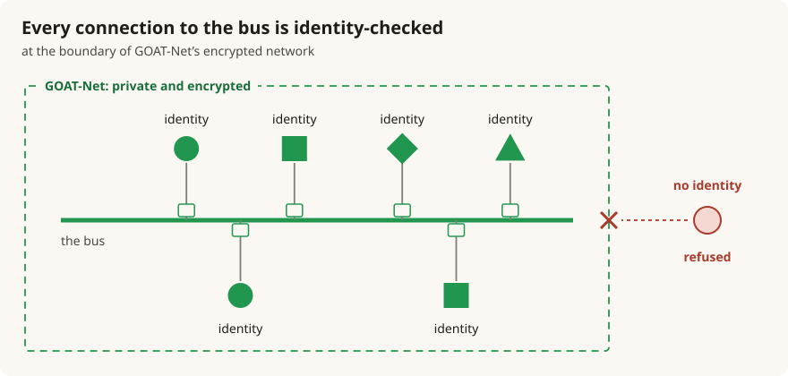

# goatdocs

<picture>
  <source media="(prefers-color-scheme: dark)" srcset="docs/figures/identity-at-the-boundary-dark.svg">
  
</picture>

Architecture, strategy, design system and integration guides for goat: the documents that explain the system and the thinking behind it.

[](LICENSE)

> [!NOTE]
> goat is pre-1.0: interfaces can still change between releases.

The explanatory corpus for goat — the design documents, reference material, design system, positions and templates that explain the system and the thinking behind it, as distinct from the component documentation that lives beside the code in [`goatcore`](https://github.com/usareur-af/goatcore).

| Directory | What |
|---|---|
| `docs/design/` | architecture overviews, strategy, technology evaluations, engineering baselines, patterns — the designs that are not one component's |
| `docs/reference/` | reference material: glossaries, lexicons, comparative tables, [the open-source projects goat is built with](docs/reference/built-with.md), and [every goat repository](docs/reference/repositories.md) |
| `docs/design-system/` | the design system every goat surface renders with |
| `docs/manifesto/` | positions: phoenix-native peers, queryable by default, the licence-tier posture, substrate not platform |
| `docs/partner-templates/`, `docs/vendor-templates/` | the documents a partner or vendor is handed |

Where a document here cites code, it cites `goatcore` by path; where it describes a component, the component's own design document in `goatcore/docs/design/` is canonical and this corpus links to it.

Start at [docs/INDEX.md](docs/INDEX.md). Every public goat repository is listed in [docs/reference/repositories.md](docs/reference/repositories.md), generated from GitHub by `.github/repositories/index.py`. The same documents are published as a website at <https://usareur-af.github.io/goatdocs/>, built from `main` by [`.github/workflows/pages.yml`](.github/workflows/pages.yml) with MkDocs ([`mkdocs.yml`](mkdocs.yml)). Preview it locally with `pip install -r .github/pages/requirements.txt && mkdocs serve`.

## Claude Code skills

Two skills for work across every public goat repository live in [`.claude/skills/`](.claude/skills/): `splash-page` builds a repository's landing page on GitHub Pages in the house style ([what it builds](https://usareur-af.github.io/goatdocs/goat/splash-page/), [every page built with it](https://usareur-af.github.io/goatdocs/goat/pages/)), and `changelog` writes a changelog entry. This repository is also a Claude Code plugin marketplace, so one install makes both skills available in every repository, including a new, empty one:

```
/plugin install goat-skills --marketplace USAREUR-AF/goatdocs
```

## Built with

goat runs on and builds with open-source projects including Eclipse Zenoh, NetBird, WireGuard, Ory, SPIFFE/SPIRE, PostgreSQL with pgEdge Spock, and Prometheus. The full list, with licences and what each is used for: [docs/reference/built-with.md](docs/reference/built-with.md).

## Contributing and licence

Docs follow the same pull-request process as code: [CONTRIBUTING.md](CONTRIBUTING.md). Every document states what is *built*, *designed* or *not built*; a document that does not is a defect. Apache License 2.0 ([LICENSE](LICENSE)).

## Licence

`goatdocs` was written by U.S. Federal government employees. In the U.S. it is not subject to copyright and is in the public domain; in countries where copyright is recognized, it is released under the [Apache License 2.0](LICENSE). See [INTENT.md](INTENT.md).
