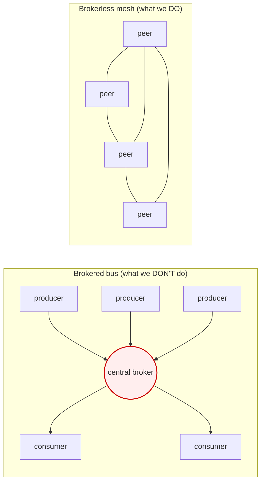
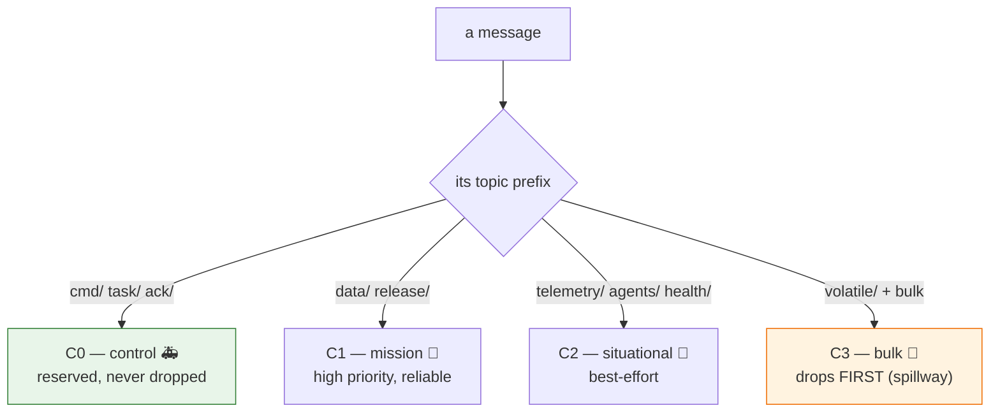
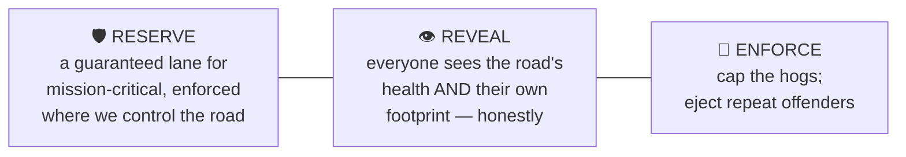
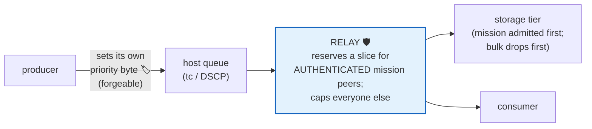
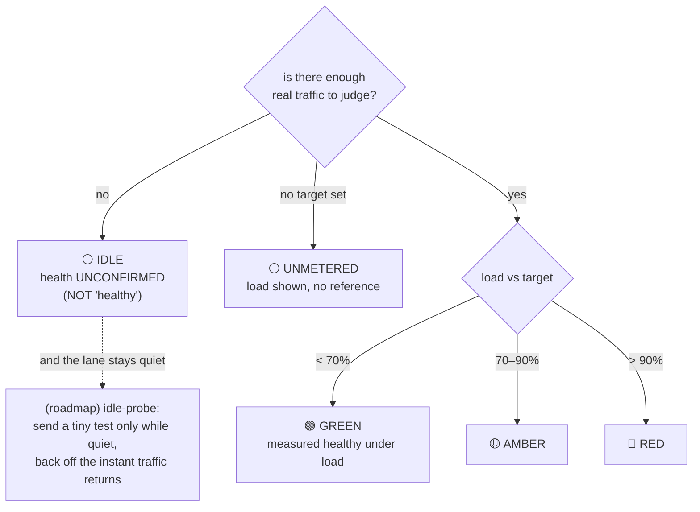
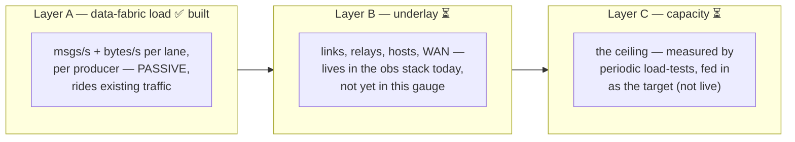
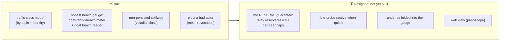

# Protecting mission-critical data — how Quality of Service works on the fabric

> **A standalone guide, two reading levels.** Each idea is explained first in plain language
> (the **In short** line), then with the real mechanism (the **Deeper** note). If you only read
> the **In short** lines and look at the pictures, you'll get the whole story. The canonical
> detail lives in the design docs and ADRs linked at the end — this guide is the map, not the
> territory.

---

## The promise, in one paragraph

The data fabric carries everything from life-or-death command messages to bulk file transfers,
all over the same mesh. **The most important data must keep flowing even if everything else
misbehaves at once** — a buggy sensor, a hostile vendor, a saturated link. This guide explains
how we make that true *without* a central traffic cop (we deliberately don't have one), how we
let everyone *see* the network's health honestly (no fake "all clear"), and how we measure it all
*without* adding traffic that would slow the very network we're trying to protect.

---

## 1. The hard part: there is no central traffic cop

**In short.** Most messaging systems have a single hub every message passes through (a "broker").
That hub is one convenient place to enforce priority. We don't have one — our data goes
**directly, peer to peer**, like cars on a road network with no central tollbooth. That's what
lets us scale enormously, but it means we can't put one guard at one gate. So we guard at every
junction instead.

**Deeper.** The fabric is brokerless (Zenoh over a WireGuard mesh); the management plane is out of
the data path. A central broker would be a single chokepoint and a single point of failure —
exactly what we're avoiding. The trade is that Quality of Service becomes a
*per-hop* discipline (the same model the internet uses — DiffServ), not a central-controller one.

*The broker is one place to enforce priority — and one place to fail, and one ceiling on scale.
The mesh has neither; QoS must be enforced at each junction the traffic actually crosses.*

---

## 2. The lanes: four traffic classes

**In short.** We sort all traffic into **four lanes** by how important it is — like a road with an
**ambulance lane**, a **mission lane**, a **normal lane**, and a **bulk/cargo lane**. The bulk
lane is the first to slow down when the road gets busy, so the important lanes stay clear.

**Deeper.** The class is fixed by the **topic name** (which is already access-controlled), so a
producer can't promote its own traffic to a higher lane:

| Lane | Class | Carries | Under pressure |
|---|---|---|---|
| 🚑 Ambulance | **C0 control** | commands, tasking, acks, the health signal itself | reserved, never dropped |
| 🎯 Mission | **C1 mission** | tracks, alerts, detections, releases | high priority, reliable |
| 🚗 Normal | **C2 situational** | telemetry, agent output, component health | best-effort |
| 🚚 Bulk | **C3 bulk** | the non-persisted firehose + large-file transfer | **drops first** — the spillway |

*The non-persisted `volatile/` class (high-rate telemetry + large files) is deliberately the
bottom lane — it's loss-tolerant by design, so it sheds first and protects the lanes above it.*

---

## 3. The three pillars

Everything rests on three ideas. **Reserve** keeps a lane clear for the mission; **Reveal** lets
everyone see the road honestly; **Enforce** stops the hogs. Cooperation is the optimization on
top — it is *never* the guarantee.

### Pillar 1 — Reserve: a guaranteed lane, recognized by *credentials* not by a *sticker*

**In short.** We keep a slice of the road **permanently reserved** for mission-critical traffic.
And crucially: you're recognized as "allowed in the ambulance lane" by your **verified
credentials**, *not* by a sticker anyone could print. A flood can't just *claim* to be important.

**Deeper.** The reservation is enforced at every point we control — the **relay** (the one shared
chokepoint for CGNAT-forced flows), the **storage tier**, and **owned-host network queues**. It
keys on **authenticated peer identity** (the relay already verifies it), **not** on a priority
byte (DSCP) that the sender sets — because the relay forwards opaque encrypted packets and an
untrusted producer controls its own header. This is the single most important correctness point:
**a hostile producer cannot paint "ambulance" on its truck.**

*The producer's own priority is a hint that orders **its own** traffic. The guarantee lives at
the relay and keys on **who you are**, verified — not what you claim.*

### Pillar 2 — Reveal: an honest gauge everyone can read (including their own footprint)

**In short.** There's a big, honest **health gauge** anyone can read — `goat health` — showing
how busy each lane is and **how much of the road *you* are using**. When it can't tell, it says
**"I can't tell,"** never a fake "all clear." Seeing your own impact is what makes people
self-correct.

**Deeper.** A small always-on meter (`goat-fabric-health`) watches the traffic that's *already
flowing* and publishes the picture back onto the bus. It is **honest by construction** — see §4.

### Pillar 3 — Enforce: cap the hogs, eject the repeat offenders

**In short.** A producer using too much gets its speed **capped**. A persistent abuser gets its
**road pass revoked** entirely.

**Deeper.** Over-rate producers are flagged by the expected-vs-actual monitor; per-peer caps at
the relay are the hard ceiling; and the brokerless-correct way to stop a bad actor is to **eject
it from the mesh** (instant credential revocation) — you don't rate-limit it in a central
data-plane component you don't have.

---

## 4. How we *know* it's working — without ever lying

This is the part people care about most, because **a health gauge that lies is worse than none** —
a fake "green" gets trusted, and someone relies on capacity that isn't there. Five rules are
non-negotiable:

**In short.**
1. **An honest "I can't tell" beats a fake "all clear."** If a lane has no traffic, the gauge
   says **IDLE — unconfirmed**, *not* green. Green means *measured healthy under real traffic*.
2. **Every reading shows its evidence** — how many messages it's based on, over what window. You
   can always ask "is this green *measured*, or just *quiet*?"
3. **We never confuse measured, assumed, and inferred.** Live load is *measured*; the capacity
   target is an *estimate* from periodic load-tests; headroom is *inferred* from the two — and the
   gauge keeps them visibly separate.
4. **One glance on top, detail underneath** — a single dipstick (GREEN / AMBER / RED / IDLE).
5. **Measuring must not slow the network.** The meter *rides existing traffic* (it adds nothing).
   We only generate test traffic when a lane is **quiet**, and we stop the instant real traffic
   returns.

*The gauge has **five** states, not three. A quiet lane is `IDLE`, never a false green. That same
"quiet" is the only time we'd ever inject a test probe — so diagnostics never compete with the
mission.*

### What we measure, and what we don't (be honest about the layers)

**In short.** Today's gauge measures **how busy each lane is** (built, and it's passive — free).
The health of the underlying links, and the true ceiling, are measured **elsewhere** (the
observability stack; periodic load-tests) and aren't folded into this gauge *yet* — and we say so
rather than implying we measure everything. The satellite/WAN link in particular we **cannot
guarantee** — no design can reserve bandwidth on a third-party satellite — so we **measure and
show** it instead of pretending.

---

## 5. The concerns this resolves

> **"What stops a vendor or partner from flooding the network?"**
> They can't even *write* to the mission lane — the lane is gated by identity + topic, both
> verified. Their bulk traffic is in the drop-first lane. At the shared chokepoint (the relay)
> they're capped per-peer, and the mission slice is reserved for *authenticated* mission peers, so
> a flood lands in the leftover best-effort pool. Persistent abuse → ejected from the mesh. The
> mission lane's guarantee does **not** depend on the flooder's goodwill.

> **"How do I trust the green light?"**
> Green only appears when we **measured** the lane healthy under **real load**, and the reading
> carries its evidence (the sample count). A quiet lane shows **IDLE (unconfirmed)**, never a fake
> green. No target → **UNMETERED**, not green.

> **"Does monitoring the network add load and become the problem?"**
> No. The meter is **passive** — it watches traffic already flowing and adds nothing, and its own
> health signal rides the reserved control lane so it can never crowd out the mission. The only
> active test (the idle-probe) fires **only when a lane is quiet** and yields the instant real
> traffic appears.

> **"What about the link we don't control?"**
> We reserve at every point **we** control (relay, storage, our own hosts). The satellite segment
> we **measure and surface** honestly — we never paint it green by assumption.

> **"Is this real or a slide deck?"**
> Honestly mixed, and we mark which is which (next section). The lane model and the **honest health
> gauge are built**; the **hard reservation at the relay** — the part that delivers the literal
> guarantee against an adversary — is the heaviest piece and is **designed, not yet built**.

---

## 6. What's built vs. what's designed (no overclaiming)

The cooperative + transparency layers (which protect the common case and make impact visible)
are the cheap, high-leverage part and are **done**. The hard, adversary-proof guarantee is the
relay reservation — real engineering, the heaviest phase, and **honestly still ahead of us**. We
build the cheap protections first because they remove most of the risk; we're clear-eyed that the
last-mile guarantee against a determined adversary is the work that remains.

---

## Where the real detail lives

- **The QoS strategy (the three pillars, the reservation, the enforcement map):**
  [`zenoh-qos-and-prioritization.md`](https://github.com/usareur-af/goatcore/blob/main/docs/design/zenoh-qos-and-prioritization.md) / ADR 1033.
- **The health gauge (the meter, the schema, the honesty rules, the layers):**
  [`fabric-health-surface.md`](https://github.com/usareur-af/goatcore/blob/main/docs/design/fabric-health-surface.md) / [ADR 1034](https://github.com/usareur-af/goatcore/blob/main/docs/adr/1034-fabric-health-surface.md).
- **The bottom lane / spillway:** [`zenoh-volatile-class.md`](https://github.com/usareur-af/goatcore/blob/main/docs/design/zenoh-volatile-class.md) /
  [ADR 1032](https://github.com/usareur-af/goatcore/blob/main/docs/adr/1032-zenoh-volatile-non-persisted-namespace-class.md).
- **Where capacity numbers come from (and why we don't assert them here):**
  [`zenoh-loadtest.md`](https://github.com/usareur-af/goatcore/blob/main/docs/design/zenoh-loadtest.md) / [ADR 1012](https://github.com/usareur-af/goatcore/blob/main/docs/adr/1012-load-testing-discipline.md).
- **Why brokerless / the scaling story:** `goat-net-scaling.md` §"Message-rate scale".

This guide is intentionally analogy-first; every claim above is grounded in those documents, and
where something is *designed but not built* we have said so plainly.
