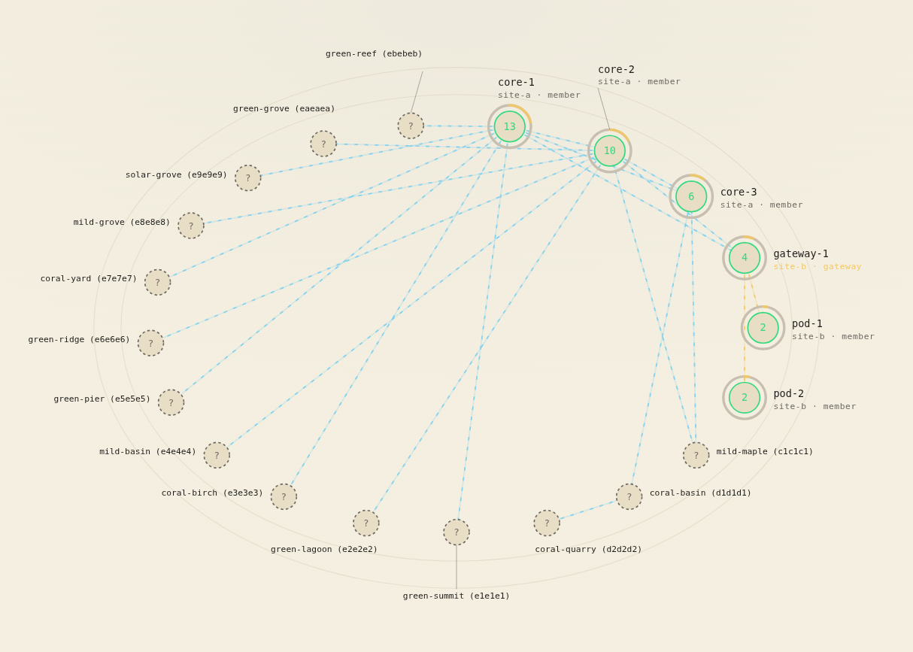
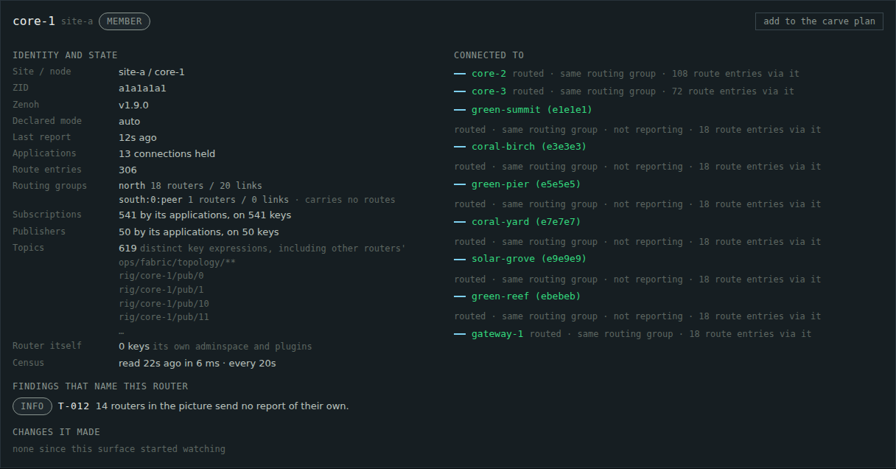
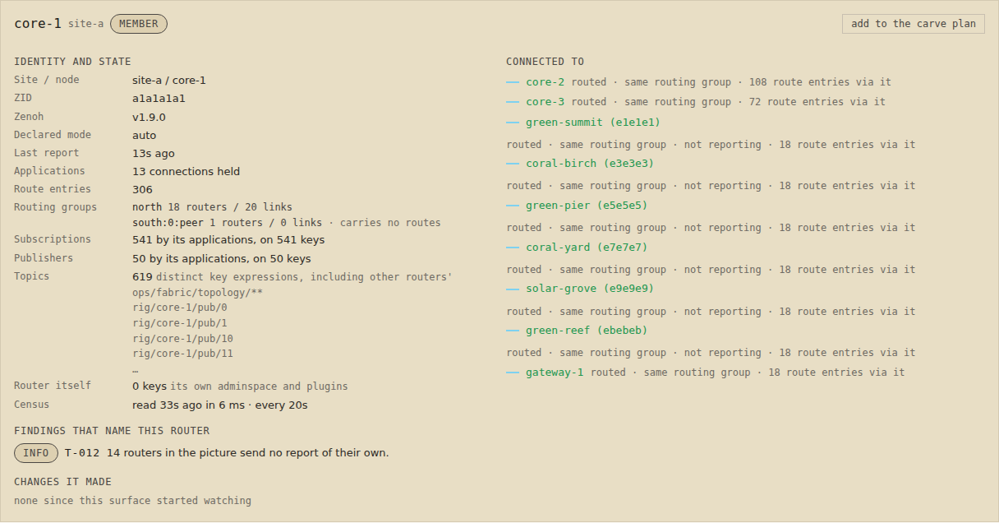
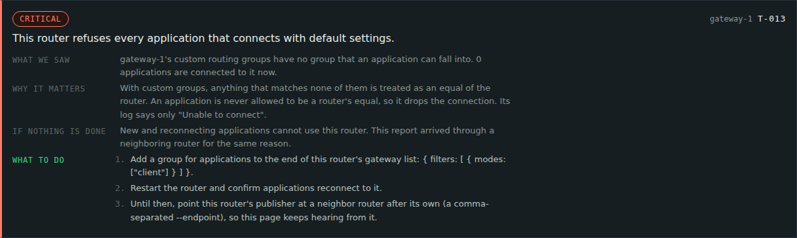
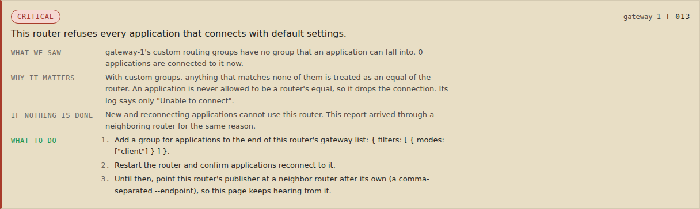

# The Zenoh topology service

The topology service draws a Zenoh router fabric as a graph: every router, the routing group each link belongs to, which routers send no report of their own, who operates each router, and how many subscriptions, publishers and key expressions each one carries. Each router's own host reads that router and publishes what it finds; the page reads only those reports, so opening it sends no query to any router.

**Status.** Built, in goatstuff `ops/goat-topology` (the graph, routers that send no report, names and owners, per-router counts, and the findings). Every image on this page is from a local test rig of 22 stock `eclipse/zenoh` 1.9.0 routers with generic names (`core-1`, `gateway-1`, `pod-1`, …) and synthetic ZIDs, run with no peer directory and no roster configured (measured 2026-11-16). The component's design document, which is canonical, is [`docs/design/zenoh-topology-surface.md`](https://github.com/usareur-af/goatstuff/blob/main/docs/design/zenoh-topology-surface.md) in goatstuff.

<!-- Recording: the 90-second screen recording of the rig page (graph filling in, a router that sends no report, a router going quiet and T-006, the counts) goes on the line below once it is uploaded; see the pull request. -->

## How it gets its data

The service is one binary, `goat-topology`, with two modes. `publish` runs next to each router. `serve` runs once per fabric and draws the page.


| Step | What happens |
|---|---|
| 1. Router | `zenohd` with the REST plugin bound to `127.0.0.1:8000` and the adminspace readable. |
| 2. Publisher | On the router's own host. Every 30 seconds it reads four adminspace keys of that router: `@/local/router` (sessions), `@/local/router/linkstate/*` (each routing group's graph), `@/local/router/route/successor/**` (the route table) and `@/local/router/status/plugins/rest/version`. Every 300 seconds it also reads `@/local/router/subscriber/**` and `@/local/router/publisher/**`. It also reads the `gateway` block of the router's configuration file. |
| 3. Fabric key | The publisher puts one protobuf message, `RouterTopologyV1`, on `ops/fabric/topology/<site>/<node>`. |
| 4. Surface | `serve` subscribes to `ops/fabric/topology/**`, keeps the latest message from each router in memory, and builds the page's data once each time a message arrives. |
| 5. Browser | Polls the surface every 15 seconds. When nothing has changed the answer is an HTTP 304 with no body. |

The publisher reads `@/local/...`, never `@/**`. An adminspace query is routed: `@/**` would return the adminspace of every reachable router, so a per-router read would become a fabric-wide one.

On the rig, with one router holding 541 subscriptions and 22 routers in its group, the four snapshot keys took 3.3 ms and 46 KB to read (median of 100). The subscriber and publisher tables took 4.4 ms and 123 KB. Reading all of `@/local/**` instead took 5.1 ms and 178 KB.

## What the page shows

### The routing graph


<details><summary>The same graph in the light theme</summary>



</details>

- **Reporting routers** are the full circles. The number inside is the count of sessions the router holds; the amber arc around it grows with that count and is full at 60.
- **Routers that send no report** are the small dashed circles marked `?`. A router appears even when no publisher runs on its host, because the routers that do report list it in their link-state graphs. Its links are real. Its settings and load are unknown and are shown as blank, never as zero.
- **Routed links** (blue) join two routers in the same routing group (`north`). **Terminated links** (amber) join a gateway to a router below it (`south:<id>:router`).
- **Labels.** The first line is the router's name: its node name if it reports, otherwise the name of the mesh peer it connects from when a peer directory is configured, otherwise a display name derived from its ZID (for example `coral-quarry (d2d2d2)`). A reporting router's second line is its site and role (`member` or `gateway`). When a roster is configured, a last line gives the organization and that organization's nation.

### Who operates a router

Selecting a router opens its detail. The owner fields described below come from two optional files on the surface's host, a peer directory and a roster. Built: without them, a router that sends no report keeps a name derived from its ZID. Designed, not built: with neither file configured, the page shows no owner column and no owner fields at all; today it still shows them empty.

The surface finds the owner without asking the fabric or the mesh controller for anything:

1. A reporting router's message already holds, for each session, the address it comes from.
2. A peer directory file on the surface's host maps that address to a mesh peer name, hostname and groups.
3. The peer name leads to a handle in the identity roster, and the roster gives the organization, the organization's nation, and the individual with that person's own nationality.

An organization's nation and a person's nationality are two separate facts, and the page never fills in one from the other. A machine has no nationality: for a machine, the detail shows the person who enrolled it and that person's nationality, labeled as theirs. A fact the roster does not hold is shown as `not recorded`. A peer name is evidence of ownership, not a record of it, and the detail says that the owner was found through the peer name.

A router stays unnamed in three cases, and its detail says which: no reporting router holds a session with it (it is known only through link state), its address is not in the peer directory, or no peer directory is configured.

### What each router carries

The routers table lists every router with its mode, what it carries (subscriptions, publishers and topics for a reporting router; subscribed keys as a reporting router sees them for one that sends no report), its routing groups, its route entries and the age of its last report.

The counts are declarations from each reporting router's own tables, not traffic. In the subscriber table, each entry is one key expression with the sources that declared it:

| Source list | Holds | What the page can say |
|---|---|---|
| `clients`, `peers` | this router's own sessions that declared the key | how many subscriptions this router's applications hold, and on how many keys |
| `routers` | every other router in the routing group that holds the key; a declaration below a gateway is attributed to that gateway | how many keys each other router holds, including a router two hops away and one that sends no report |

The publisher table lists only the router's own sessions, so the number of publishers that another router holds is not visible. The page publishes counts and at most five key expressions per router, never the full list. The detail of a reporting router also lists, for each neighbor, how many route-table entries use that neighbor as the next hop.



<details><summary>Light theme</summary>



</details>

### Findings

Each finding states what was seen, why it matters, what happens if nothing is done, and what to do.



<details><summary>Light theme</summary>



</details>

| Finding | Raised when | Severity |
|---|---|---|
| `T-001` | a `gateway.south` filter matches on `zids` or `region_names`, values the peer states about itself | critical |
| `T-002` | a subregion has an empty filter list, so it matches nothing | critical |
| `T-003` | routers disagree on the gateway mode | warning |
| `T-004` | router A lists router B and B does not list A | warning |
| `T-005` | the route table size differs from Σ V(V−1) over the router's groups that have links | warning |
| `T-006` | a router has sent no report for three of its intervals | warning |
| `T-007` | routers report different Zenoh versions | warning |
| `T-008` | a router is alone in its group | info |
| `T-009` | how route-table size grows as routers are added | advisory |
| `T-010` | a custom gateway's declared subregions are not the ones running | critical |
| `T-011` | the router's configuration file could not be read | warning |
| `T-012` | routers appear in a link-state graph and send no report | info |
| `T-013` | a custom gateway has no subregion that a default client can match, so it refuses every application | critical |

## Running it against your own fabric

The service needs only `zenohd` 1.9.0 with the REST plugin. The names and owners are optional; without a peer directory and a roster the page uses derived names and says why.

1. **On each router**, enable the REST plugin on loopback and allow adminspace reads:
   ```json5
   plugins: { rest: { http_port: "127.0.0.1:8000" } },
   adminspace: { enabled: true, permissions: { read: true, write: false } },
   ```
2. **On each router host**, run the publisher. The image is `ghcr.io/usareur-af/goat-topology` (public); building from [`ops/goat-topology`](https://github.com/usareur-af/goatstuff/tree/main/ops/goat-topology) with `cargo build --release` also works.
   ```bash
   goat-topology publish --endpoint tcp/<this router>:7447 --site <site> --node <node> \
     --admin-addr 127.0.0.1:8000 --config-path <router config file>
   ```
   With access control on, the publisher's identity needs `put` on `ops/fabric/topology/**`. For a TLS endpoint, add `--cert`, `--key` and `--root-ca`.
3. **Once per fabric**, run the surface and open its address:
   ```bash
   goat-topology serve --endpoint tcp/<any router>:7447 --bind 127.0.0.1:8080 \
     [--peer-directory <file>] [--roster <file>]
   ```
   Its identity needs to subscribe to `ops/fabric/topology/**`. The page loads nothing from outside its own address.
4. **To see the rig on one machine**, build the binary and its `rig-client` example, set `RIG_IMAGE` to a `zenohd` 1.9.0 router image by digest, and run [`ops/goat-topology/rig/rig.sh`](https://github.com/usareur-af/goatstuff/blob/main/ops/goat-topology/rig/rig.sh) `up`, then `check`, which compares the page with what the rig declared. The script's header lists the exact commands.

`goat-topology inspect` prints, as JSON, what the publisher would send for the router on this host, and publishes nothing.

## What it cannot know

- **Messages and bytes.** The router build measured here exposes no traffic counters (`router/metrics` holds only `zenoh_build_info`). Counting traffic needs a router built with Zenoh's `stats` feature. Not built.
- **Traffic between two routers that both send no report.** No reporting router sees it, whatever the build.
- **Publishers held by another router.** Zenoh 1.9.0 keeps publishers only for a router's own sessions.
- **Routers below a gateway that sends no report.** A `south` group is known only to its gateway, so those routers are not drawn. Run the publisher on the gateway.
- **The settings and load of a router that sends no report.** Its links are real; everything else about it is blank.
- **The recorded owner of a peer.** The owner is found through the peer name and the roster, not through an enrollment record.
